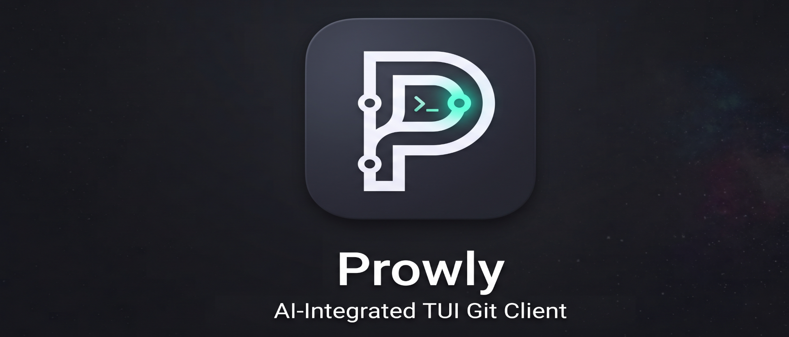

<p align="center">
  
</p>

<p align="center">
  <strong>コンテキスト連動型 AI コパイロットを常時統合した、超高速・安全第一のターミナル Git & GitHub クライアント</strong>
</p>

<p align="center">
  <a href="#主な機能">主な機能</a> •
  <a href="#インストール--デスクトップランチャー統合">インストール</a> •
  <a href="#クイックスタート">クイックスタート</a> •
  <a href="#キーバインド一覧">キーバインド</a> •
  <a href="#aiコパイロット設定-byok">AI設定</a> •
  <a href="#カラーテーマ-全21種類">テーマ</a> •
  <a href="README.md">English README</a>
</p>

---

## 概要

**Prowly** は、Rust、Ratatui、Crossterm で構築された次世代のターミナルユーザーインターフェース (TUI) Git & GitHub クライアントです。ターミナルで作業を完結させるエンジニアのために設計されており、超高速なローカルGit操作、深いGitHubワークフロー統合、安全第一のソフト破棄バックアップ、そして常に手元で支援するAIコパイロットを完全に統合しています。

キーボードのショートカット操作はもちろん、直感的なマウス操作（クリック、スクロール、右クリックコンテキストメニュー）にも完全対応しており、Linux、macOS、Windows のいずれの環境でも快適で美麗な開発体験を提供します。

---

## 主な機能

- ⚡ **ハイブリッド Git アーキテクチャ**: 高速なインプロセス `git2` によるメモリ内検査と、高度なGit CLI処理の自動フォールバックを両立。
- 🛡️ **ソフト破棄（Soft-Discard）安全設計**: 変更の破棄 (`discard`) やリセットを行っても、コードを永久に失うことはありません。実行前に自動的に一時バックアップ（セーフティースタッシュ）が作成されます。
- 🤖 **全面統合 AI コパイロット（BYOK対応）**:
  - どの画面からでも即座に呼び出せるコンテキスト連動モーダル (`Ctrl+A`)。
  - Conventional Commits 準拠のコミットメッセージ自動生成 & コミット前コードレビュー (`Ctrl+R`)。
  - GitHub Actions CI 失敗時のログ解析と原因特定・修正提案。
  - 要約と変更内容を含んだ Pull Request ドラフト本文の自動生成。
  - AI による競合コードのインテリジェントマージ（両ブランチの意図を汲み取った結合）。
  - 自然言語リクエストから Git コマンドへの自動翻訳とリスク判定 (`Safe` / `Caution` / `Dangerous`)。
- 📂 **ディレクトリマップ & 一括ステージング**: リポジトリ全体の変更ツリーを可視化し、フォルダ単位での一括ステージング・アンステージングが可能。
- 🌲 **ネイティブ Git ワークツリー管理**: スタッシュ退避なしで別ブランチの作業ディレクトリを瞬時に作成・切り替え・整理。
- 🐙 **第一級の GitHub 統合**:
  - プルリクエスト一覧、詳細閲覧、ローカルへのチェックアウト。
  - GitHub Actions ワークフロー履歴とログストリーミング。
  - Dependabot やセキュリティアラートの通知確認。
  - レートリミット保護ガードと TTL インメモリキャッシュ。
- ⚔️ **ビジュアル・コンフリクトリゾルバ**: `Current`（自分側）と `Incoming`（相手側）を並べて比較し、ワンキーで選択、または AI スマートマージで解消。
- 🔀 **クイック・インタラクティブ・リベース**: Vim のバッファを直接編集することなく、直前のコミット群を視覚的にスカッシュ (`squash`)、リワード (`reword`)、フィックスアップ (`fixup`)。
- 🧭 **3層積層コマンドパレット (`:` / `F1` / `Ctrl+P`)**:
  - 第1層（Prowly組み込み操作の高速ファジー検索 & 全件仮想スクロール）
  - 第2層（110+標準Git CLIサブコマンドカタログ・カテゴリバッジ表示）
  - 第3層（引数・オプション直接入力 & Tabフラグ自動巡回補完）
  - パンくずリスト、Esc/Backspace階層ロールバック、直打ちジャンプ、破壊的操作（force push, hard reset等）の2段階確認セーフティガードを完備。
- 🎨 **厳選された全21種類のカラーテーマ**: Tokyo Night、Catppuccin、Gruvbox、Nord、Dracula、Solarized、Everforest、Cyberpunk など。
- 🌐 **完全なバイリンガル対応**: 英語と日本語をワンキー (`l`) で即時切り替え。
- 🚀 **アプリランチャー & デフォルトターミナル自動起動**: FreeDesktop 仕様の `.desktop` エントリとアイコンを自動登録し、システムのデフォルトターミナルで起動。

---

## インストール & デスクトップランチャー統合

### Linux / FreeDesktop 環境（推奨）

リポジトリをクローンし、付属のインストールスクリプトを実行してください:

```bash
git clone https://github.com/wammed/Prowly.git
cd Prowly
./scripts/install.sh
```

#### `install.sh` の処理内容:
1. 最適化されたリリースバイナリをビルド (`~/.local/bin/prowly`)
2. スケーラブルなSVGアプリアイコンを登録 (`~/.local/share/icons/hicolor/scalable/apps/prowly.svg`)
3. `~/.local/share/applications/prowly.desktop` に `.desktop` ファイルを生成:
   ```ini
   [Desktop Entry]
   Name=Prowly
   Exec=~/.local/bin/prowly
   Icon=prowly
   Terminal=true
   Type=Application
   Categories=Development;RevisionControl;ConsoleOnly;
   ```
4. **結果**: お使いのデスクトップ環境（GNOME, KDE Plasma, Rofi, Wofi, Albert など）のアプリランチャーに Prowly のアイコンが表示され、クリックすると**システムのデフォルトターミナル**で自動起動します！

アンインストール:
```bash
./scripts/uninstall.sh
```

### Windows 環境

PowerShell でスクリプトを実行します:
```powershell
.\scripts\install.ps1
```

### Cargo による手動ビルド

```bash
cargo build --release
cp target/release/prowly ~/.local/bin/
```

---

## クイックスタート

任意の Git リポジトリ配下で起動します:

```bash
prowly
```

またはリポジトリのパスを指定して起動:

```bash
prowly /path/to/repo
```

---

## キーバインド一覧

### 全体共通操作
| ショートカット | 機能 |
|:---|:---|
| `1` | **変更 (Changes)** ビューへ切り替え |
| `2` | **プルリクエスト (PRs)** ビューへ切り替え |
| `3` | **Actions & CI** ビューへ切り替え |
| `4` | **アラート (Alerts)** ビューへ切り替え |
| `5` | **ワークツリー (Worktrees)** ビューへ切り替え |
| `Tab` | ペイン間のフォーカス移動 |
| `:` または `F1` | **コマンドパレット**（あいまい検索 & 自然言語Git翻訳） |
| `Ctrl+A` | **全面統合 AI アシスタント**を起動 |
| `Ctrl+D` | **リポジトリ健康診断**を実行 |
| `t` | カラーテーマの順次切り替え（全21種） |
| `l` | 表示言語の切り替え（英語 / 日本語） |
| `e` | 外部エディタ (`$EDITOR`) の起動（一時中断・復帰） |
| `m` | コンテキストメニューを開く（左クリック `[ 󰍜 Menu ▾ ]` と同等） |
| `?` | ヘルプ & キーバインド一覧モーダルの表示 |
| `q` / `Esc` | モーダルを閉じる / Prowly を終了 |

### 変更 & 差分ビュー
| ショートカット | 機能 |
|:---|:---|
| `Space` | 選択中ファイルのステージ / アンステージ切り替え |
| `a` | すべての変更をステージ |
| `u` | すべての変更のステージを解除 |
| `d` | 変更のソフト破棄（安全バックアップ退避付き） |
| `c` | コミットメッセージ入力ダイアログを開く |
| `Ctrl+G` | AI によるコミットメッセージ自動生成 |
| `Ctrl+R` | AI によるコミット前コードレビュー |
| `j` / `k` または `↓` / `↑` | ファイル一覧 / 差分のスクロール |
| `PageDown` / `PageUp` | 差分の高速スクロール |

### コンフリクト解消 & ワークツリー
| ショートカット | 機能 |
|:---|:---|
| `1` | 現在の変更 (HEAD) を採用 |
| `2` | 取り込み元の変更を採用 |
| `3` | 両方の変更を残す |
| `m` | AI によるスマートマージを実行 |
| `w` | 解消内容をファイルに保存 |
| `n` | 新規ワークツリーの作成 |
| `x` | 選択中のワークツリーを削除 |

### マウス操作 & 端末エミュレータ互換性（右クリック競合について）

Prowly はクリックでのファイル選択、チェックボックス切り替え、ホイールスクロール、ボタン操作など、マウス操作に完全対応しています。

> [!NOTE]
> **右クリックと端末エミュレータの競合仕様**
> 
> - **端末エミュレータによる動作の違い**:
>   - **TUI 親和的端末 (Alacritty, Kitty, WezTerm, Foot 等)**: アプリへのマウスパススルーが標準で有効なため、ファイル一覧などを**右クリック**して直接コンテキストメニューを開けます。
>   - **デスクトップ標準端末 (GNOME Terminal, XFCE Terminal 等の VTE 系、Windows Terminal の既定設定)**: 端末ウィンドウ側のネイティブ GUI メニュー（コピー・貼り付け等）が OS のイベントループで優先的に消費（横取り）されるため、アプリ側へ右クリックイベントが送信されない、または端末側のメニューと重なる現象が発生します。これは子プロセス側から制御できない端末エミュレータ固有の仕様・制限です。
> - **Prowly の全端末互換アプローチ**:
>   - すべての端末環境で右クリックに依存せず100%確実にコンテキスト操作を行えるよう、画面上に**左クリック対応の `[ 󰍜 Menu ▾ ]` ボタン**を配置しています。
>   - 右クリックが端末に横取りされる環境でも、**左クリックまたは `m` キー**により、すべての機能（エディタ起動、パスのコピー、破棄など）を確実に呼び出せます。

---

## AIコパイロット設定 (BYOK)

Prowly は **Bring-Your-Own-Key (BYOK)** 方式を採用しており、主要な LLM プロバイダーと直接連携します:

- **OpenAI** (`gpt-4o`, `gpt-4o-mini`)
- **Anthropic** (`claude-3-5-sonnet-20241022`)
- **Google Gemini** (`gemini-1.5-flash`, `gemini-1.5-pro`)
- **Ollama** (ローカルモデル: `llama3.2`, `mistral` など)
- **カスタム / OpenAI 互換エンドポイント**

### 環境変数の設定
シェル設定ファイル (`~/.bashrc`, `~/.zshrc` など) で API キーを設定します:

```bash
export OPENAI_API_KEY="sk-..."
# または
export ANTHROPIC_API_KEY="sk-ant-..."
# または
export GEMINI_API_KEY="AIza..."
```

### 設定ファイル (`~/.config/prowly/config.toml`)
```toml
[ui]
theme = "tokyo_night"
language = "ja"
nerd_fonts = true

[ai]
provider = "openai"
model = "gpt-4o-mini"
timeout_secs = 30
auto_review = true

[github]
token = "ghp_..."
```

### ローカル Ollama の利用設定
ローカルで動作している [Ollama](https://ollama.com/) を利用する場合、API キーは不要です。

```toml
[ai]
provider = "ollama"
# ローカルの Ollama にインストールされているモデル名を指定 (例: "llama3.2:latest", "deepseek-r1:latest", "ornith-1.5:35b")
model = "ornith-1.5:35b"
# エンドポイント (http://127.0.0.1:11434 または http://127.0.0.1:11434/api のどちらも指定可能)
api_base = "http://127.0.0.1:11434"
```

> **Note (エンドポイント仕様について):**  
> 他のエージェントやツールでは OpenAI 互換 API (`/v1`) を使用するために `http://127.0.0.1:11434/v1` と指定することが多いですが、Prowly の `provider = "ollama"` は Ollama ネイティブの `/api/chat` を直接呼び出す軽量設計となっています。ベース URL に `http://127.0.0.1:11434` を指定した場合も自動的に正規化されます。  
> ※ OpenAI 互換エンドポイント（`/v1`）経由で接続したい場合は、`provider = "custom"` を指定し `api_base = "http://127.0.0.1:11434/v1"` を設定してください。

---

## カラーテーマ (全21種類)

Prowly には美しい21種類のカラーパレットがプリセットされています:

- **Tokyo Night** (デフォルト)
- **Catppuccin Mocha**, **Catppuccin Macchiato**, **Catppuccin Frappe**, **Catppuccin Latte**
- **Gruvbox Dark**, **Gruvbox Light**
- **Nord**
- **Dracula**
- **Solarized Dark**, **Solarized Light**
- **One Dark**, **One Light**
- **Everforest Dark**, **Everforest Light**
- **Rose Pine**, **Rose Pine Dawn**, **Rose Pine Moon**
- **Monokai Pro**
- **Kanagawa**
- **Cyberpunk**

---

## ライセンス

Prowly は MIT ライセンスの下で公開されているオープンソースソフトウェアです。
